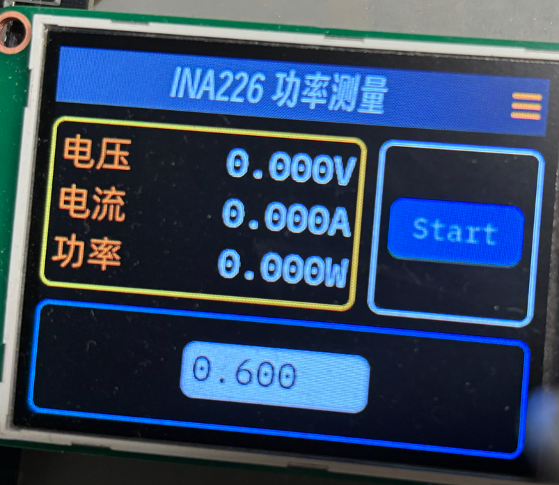

# 项目介绍

该分支：`study/single-screen-containers` 学习 LVGL 单个 screen + 多容器来设计多页面效果。

物料清单：
- ESP-IDF 5.5.6
- ESP32S3
- 2.4寸屏（ST7789) + LVGL9.6
- INA226
- ADC 按键功能

已完成的功能：

- [x] Button
- [x] LVGL + LCD
- [x] INA226
- [X] 实体 ADC Button 与 LVGL 交互

