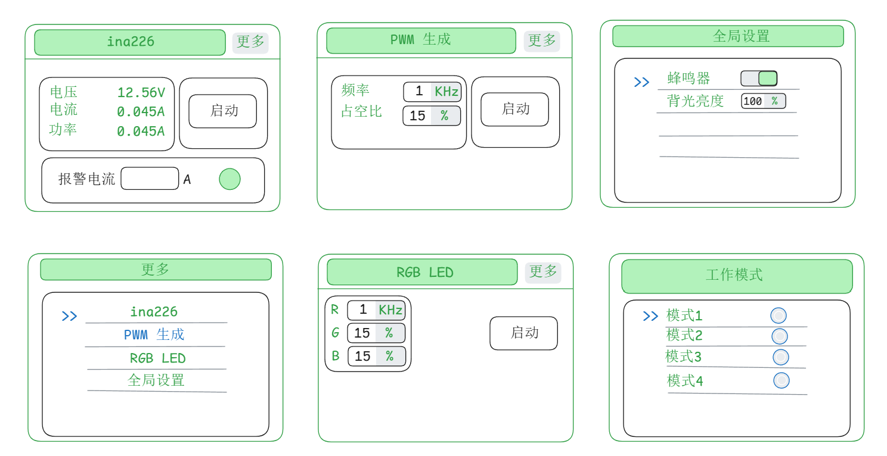

# 开发日志

## 索引
| 日期 | 模块/标签 | 主要内容 | Commit | 状态 |
|---|---|---|---|---|
| 2026-10-31 | wifi, nvs | 配网流程完善，修复 NVS 初始化崩溃 | abc1234 | 已完成 |

## 2026-11-11 周三

### 待解决问题

- [x] INA226 页面不显示聚焦点
- [x] List 页面无法保持聚焦点在当前功能列表

### 修改了

- lcd_init() 将背光配置与初始化和默认值移到了该函数的最前面

## 2026-11-10 周二

### 今日任务

- [x] 多页面 UI 的页面内容封装成独立的函数

## 2026-11-09 周一

### 问题与解决方法

- 上电时按钮闪烁（解决办法：按键创建后立即隐藏）

### 下一步要完成的工作

1. 将功能页面的内容封装成独立的函数

`AI`方案：[doc/将功能页面的内容封装成独立的函数](doc/将功能页面的内容封装成独立的函数.md)

### 工作记录

修改当前的 UI 设计，使其更符合产品化，包括按键数量都要重新规划，设计草图：



### 按键规划

- 返回按键 LV_KEY_ESC
  - 退出编辑模式
  - 退出设置页面&退出更多页面
- 确认按键 LV_KEY_ENTER
  - 切换按键状态（开/关）
  - 输入框编辑状态/退出编辑状态
- 左移按键 LV_KEY_LEFT
  - 左移光标
- 右移按键 LV_KEY_RIGHT
  - 右移光标
- 上键/上移聚焦点 LV_KEY_UP & LV_KEY_PREV
- 下键/下移聚焦点 LV_KEY_DOWN & LV_KEY_NEXT


## 2026-10-31 周五

### 今日目标
- [ ] 完成 esp_timer 与 nvs 来实现 buzzer 功能，实现掉电参数保存
- [ ] 添加 LVGL 设置页面，与用按键实现页面循环切换的功能


### 工作记录

- ST7789 SPI 速度改为 60MHz
- 开启 PSRAM 功能，并设置 SPI频率为 80MHz模式
- 修改 LVGL Malloc functions source 的方式为：`C standard library (malloc/realloc/free)`

#### 新增功能
- 添加 page_register() 页面注册函数，所有页面的创建集中管理 [](./doc/lvgl_page_circular_switch.md)
- 添加 `page_cycle_next()` 函数，切换到下一个页面

- 

#### Bug 修复
- `lv_screen_load_anim(..., true)` 第三个参数为 `true` 时出现重启现象,不用 `true` 模式
- 切面 **LVGL** 页面动画时出现白屏，非动画切换正常

### 修复方法

#### 切面 **LVGL** 页面动画时出现白屏，非动画切换正常

动画时间设置为 `200ms`,不用小于该值：

```c
lv_screen_load_anim(pages[next_index].scr, anim, 200, 0, false);
```